# Four-File Usage Flowchart

```mermaid
flowchart TD
    Start([User runs setup_meld.py]) --> LoadEnv[Load .env configuration]
    LoadEnv --> CheckRestraints{ENABLE_RESTRAINTS<br/>= true?}
    
    CheckRestraints -->|Yes| LoadSeq[📄 Load af3_tleap_sequence.dat]
    CheckRestraints -->|No| LoadSeq
    
    LoadSeq --> ParseSeq[Parse residue sequence]
    ParseSeq --> LoadPDB[📄 Load af3_tleap.pdb]
    LoadPDB --> BuildSys[Build AmberSubSystem<br/>with OpenMM]
    
    BuildSys --> RestraintsEnabled{Restraints<br/>enabled?}
    
    RestraintsEnabled -->|No| SaveStore
    RestraintsEnabled -->|Yes| TryPhi[Try load phi.dat]
    
    TryPhi -->|Found| AddPhi[Add phi torsion restraints]
    TryPhi -->|Not Found| WarnPhi[⚠️ Warn: phi.dat missing]
    
    AddPhi --> TryPsi[Try load psi.dat]
    WarnPhi --> TryPsi
    
    TryPsi -->|Found| AddPsi[Add psi torsion restraints]
    TryPsi -->|Not Found| WarnPsi[⚠️ Warn: psi.dat missing]
    
    AddPsi --> LoadDist1
    WarnPsi --> LoadDist1
    
    LoadDist1[📄 Load 25-105_CA_dist_bias.dat]
    LoadDist1 --> ParseDist1[Parse distance restraints<br/>Auto-detect offset if needed]
    ParseDist1 --> AddDist1[Add competitive distance groups<br/>Keep 90% active]
    
    AddDist1 --> LoadDist2[📄 Load 129-340_CA_dist_bias.dat]
    LoadDist2 --> ParseDist2[Parse distance restraints<br/>Auto-detect offset if needed]
    ParseDist2 --> AddDist2[Add competitive distance groups<br/>Keep 90% active]
    
    AddDist2 --> SaveStore[💾 Save Data/data_store.dat]
    SaveStore --> Complete([✅ Setup Complete])
    
    Complete --> Launch[User runs launch_remd.py]
    Launch --> LoadStore[📂 Load Data/data_store.dat<br/>All info is persisted]
    LoadStore --> RunREMD[Run REMD simulation<br/>30 replicas, 1500 steps]
    RunREMD --> WriteTraj[Write trajectory output]
    WriteTraj --> Done([🎉 Simulation Done])
    
    style LoadSeq fill:#90EE90
    style LoadPDB fill:#90EE90
    style LoadDist1 fill:#90EE90
    style LoadDist2 fill:#90EE90
    style TryPhi fill:#FFE4B5
    style TryPsi fill:#FFE4B5
    style WarnPhi fill:#FFB6C1
    style WarnPsi fill:#FFB6C1
    style SaveStore fill:#87CEEB
    style LoadStore fill:#87CEEB
    style Complete fill:#98FB98
    style Done fill:#FFD700
```



## Legend

- 🟢 **Green boxes**: Required files (all 4 present)
- 🟡 **Yellow/Peach boxes**: Optional file attempts
- 🔴 **Pink boxes**: Warnings (non-fatal)
- 🔵 **Blue boxes**: Data store operations
- ⭐ **Gold**: Final completion

## Key Observations

1. **Files only needed during setup**: All 4 required files are read during `setup_meld.py` execution. After that, everything is saved in `Data/data_store.dat`.

2. **Launch phase is file-independent**: `launch_remd.py` only reads the data store, not the original input files.

3. **phi.dat and psi.dat are truly optional**: The code gracefully handles their absence with warnings.

4. **Distance restraints use auto-offset detection**: If residue indices in the `.dat` files are absolute (e.g., 129-340), the code automatically detects and adjusts them to match the sequence.

## File Size Context

```
Total input size: ~412 KB
├─ af3_tleap.pdb           367,710 bytes (89.2%)  ← Structure
├─ 129-340_CA_dist_bias.dat 33,441 bytes ( 8.1%)  ← Restraints region 2
├─ 25-105_CA_dist_bias.dat  11,560 bytes ( 2.8%)  ← Restraints region 1
└─ af3_tleap_sequence.dat      359 bytes ( 0.1%)  ← Sequence
```

The PDB file dominates because it contains full 3D coordinates for all atoms. The restraint files are relatively compact lists of atom pairs with distances.
